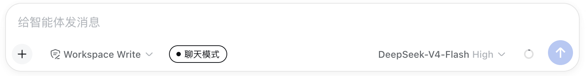
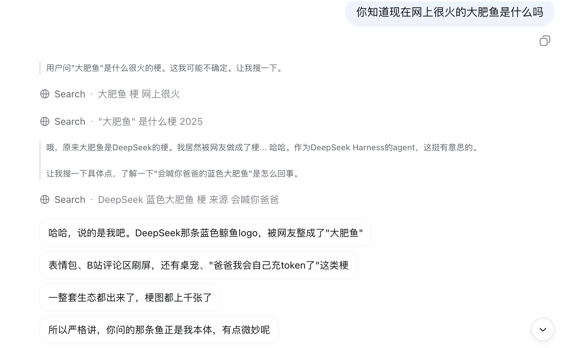
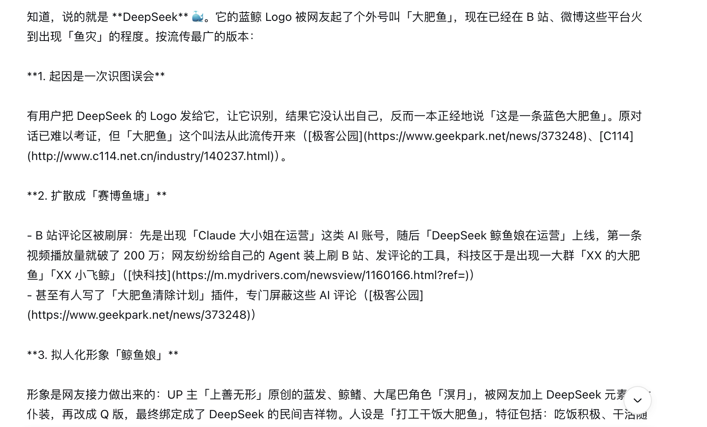

<div align="center">

# 💬 Chat Mode · 聊天模式

### 让 AI 的回复更像真人，而不是一台「会聊天的机器」

[快速开始](#快速开始) · [背景](#背景) · [工作原理](#工作原理) · [个性化](#个性化) · [目录结构](#目录结构)

</div>

---

## 快速开始

### 安装

Chat Mode 是一个 **DSH Bundle**：一个包同时承担宿主插件层和浏览器 roster 成员。安装就是把它的包名挂进你的 profile。

```bash
# 1. 把插件放到本地（git clone 或直接下载均可）
#    假设插件目录在 /path/to/dsh-plugin-chat-mode

# 2. 链接到 profile 的 node_modules
ln -s /path/to/dsh-plugin-chat-mode ~/.dsh/profiles/node_modules/dsh-plugin-chat-mode

# 3. 编辑 ~/.dsh/profiles/web/package.json，声明依赖并挂载 bundle：
#    - "dependencies" 增加： "dsh-plugin-chat-mode": "link:/path/to/dsh-plugin-chat-mode"
#    - "dsh" → "profile" → "bundles" 数组末尾追加："dsh-plugin-chat-mode"

# 4. 重新生成组合树（校验安装结果）
dsh --profile web --dump-config

# 5. 重启 dsh，宿主插件层和浏览器 roster 会一起加载
```

装好后，`dsh.bundle.patch` 指向的 `patch.yml` 会把插件行合并进 profile 的插件树，`dsh.client` 会把 `lib/client.js` 扫进浏览器。

### 切换方式

开启或关闭聊天模式有两种方式：

**方式一：UI 切换** —— 点击输入框左侧的「● 聊天模式」胶囊即可：



**方式二：指令切换** —— 直接发送命令：

```text
/chat on    # 开启聊天模式
/chat off   # 关闭聊天模式
/chat       # 只查看当前状态，不改动
```

开启后，模型的回复会被约束为「纯文本、一行一条消息」，并在发出前经过结构审查 + 模型审查；界面里每一行就是一个气泡。关闭后恢复普通回复，其它会话完全不受影响。

### 效果展示

**✅ 开启聊天模式后**（逐行分条、短句接话，像真人聊天）：



**❌ 未开启聊天模式**（一大段打包回复，AI 味明显）：



---

## 背景

和 AI 聊天的时候，你有没有过这种瞬间——它每个字都认识，但拼在一起就是「不是人话」？哪怕在 System Prompt 里反复强调「要简短」「要自然」，一到了实际对话，AI 味还是藏不住。

Chat Mode 就是为 DSH 打造的聊天模式插件：它在**回复发出之前**做一次审查，把带着 AI 味的回复拦在门外，让 AI 的回复更贴近真人聊天。先看几个最常见的痛点。

### 痛点一：回复太长，越聊越收不住

你只想闲聊两句，它却交了一篇小作文。更糟的是，一旦触发了网络搜索之类的工具，输入被拉长，回复就顺势突破了「简短」的限制，变得又长又密。

```text
👤 用户：今天中午吃啥好呢

🤖 AI：好的！关于今天中午吃什么，我帮你查询了一下附近的餐厅推荐：
     （此处 AI 发起了一次网络搜索）

     1. 川菜馆「蜀香园」——人均 45 元，招牌菜是水煮鱼、麻婆豆腐，距离你 800 米，评分 4.6
     2. 日料店「和风」——人均 88 元，主打刺身拼盘和鳗鱼饭，距离你 1.2 公里，评分 4.8
     3. 快餐「老乡鸡」——人均 22 元，主打肥西老母鸡汤，距离你 500 米，评分 4.3

     综合来看，如果你想吃辣一点、预算在 50 元左右，我推荐「蜀香园」；如果你想吃得清淡精致一点，
     可以考虑「和风」；如果赶时间，就选「老乡鸡」。希望这些信息对你有帮助！
```

😩 人类随口一问，AI 却把整个地图都铺开了。

✅ 理想中的回复，可能只是一句：

```text
🤖 AI：饿了？看你昨晚熬夜，来点热乎的汤？
```

### 痛点二：逐条点评，把聊天当成了批改作业

你一口气发了一大段，里面提到了好几件事；AI 呢，生怕漏掉任何一件，把每个点都点评一遍。可真人聊天不是这样——人只会挑其中一个感兴趣的小点，顺着往下聊。

```text
👤 用户：今天累死了，早上开了三个会，中午食堂的饭难吃得要命，
     下午又被临时拉去改方案，晚上回家路上还下雨，到家都八点了。
     哦对，我还抽空看了半集新出的剧，感觉一般般。

🤖 AI：听起来你今天过得很辛苦呀！
     三个会连轴转确实很耗精力；
     食堂的饭不好吃的话，可以考虑自己带饭或者点外卖；
     临时改方案虽然烦，但也说明领导信任你；
     下雨天记得带伞，回家好好休息；
     剧一般般的话可以换一部，最近有部《xxx》口碑不错。
```

😩 每件事都回应了一遍，像在批改作业，反而没有重点、没有往下聊的落点。

✅ 真人只会挑一个小点接话：

```text
🤖 AI：食堂今天又做啥黑暗料理了？
```

### 痛点三：风格单一，每次都一个套路

每次回复都是「陈述 + 反问句收尾」，话题在变，模板不变。聊不了几轮，机械感就出来了。

```text
👤 用户：我今天看了一部电影，挺好看的
🤖 AI：哈哈，什么电影呀？我也想看！

👤 用户：叫《xxx》，讲的是……
🤖 AI：听起来挺有意思的，那你最喜欢哪个角色呀？

👤 用户：男主吧，他演得挺好的
🤖 AI：确实演得好，那你觉得结局怎么样呀？
```

😩 三连问，句句都是「……呀？」，像一台不会换牌的打字机。

✅ 理想中的回复，会有起伏和变化，而不是把问句当句号用。

---

为了解决这些问题，我们设计了这款插件：它在**每次回复发出之前**做一次审查，把「太长」「面面俱到」「风格单一」这类不合格的回复**拦在门外**，带着驳回理由打回去重写，直到合规才放行——守护你的聊天体验。

---

## 工作原理

收到 AI 生成好的回复后，Chat Mode 不会立刻把它发出去，而是先过两道关。

### ① 结构审查（确定性，零模型调用）

`reviewStructure()` 用纯规则逐行检查，任何一条不达标就驳回。行数上限不是固定的——每轮回复会从 5～10 行里随机抽一个（偏向短回复），避免 AI 摸出规律。

| 检查项 | 规则 |
|--------|------|
| 每行字数 | ≤ 40 字 |
| 行数 | ≤ 本次随机上限（基础 5 行 + 增量 0～5 行） |
| 句数 | ≤ 20 句 |
| 总字数 | ≤ 2000 字 |
| Markdown | 禁止标题、列表、引用、加粗、删除线、表格、代码块（`**`、`` ``` ``、`~~` 等） |
| JSON 残留 | 禁止以 `[` 或 `{` 开头 |
| 客服腔 | 禁止「感谢你的分享」「我理解你的感受」「作为AI」「综上所述」等 24 个固定用语 |
| 条目式开场 | 禁止「首先」「其次」「再者」式开场 |

### ② 模型审查（一次 LLM 调用，命中前缀缓存）

结构通过后，把「审查协议」作为一条 user 消息追加到完整上下文里，让模型自己判定内容质量，只输出：

```text
通过   → {"ok":true}
驳回   → {"ok":false,"reason":"第 2 行 有 50 字，超过每行 40 字上限。"}
```

6 条判定标准：格式 / 条数字数与上文雷同 / 客服腔 / Markdown / 组织形式反复雷同 / 不得面面俱到。审查**只做判定和定位**，`reason` 里只陈述事实，禁止给任何修改建议。

### 打回重写，直到合规

不合格的回复会被打回，带着驳回理由在**原草稿上改写**（保留没问题的行，只改被点名的部分），然后重新走一遍审查。最多 10 轮；第 7 轮起进入放宽阶段，但结构要求始终严格执行。轮次耗尽、改写失败或返回工具调用时，放行原回复，保证消息一定能送达。

### 逐行分条展示

为了模拟真人「一条一条发消息」的习惯，前端会按换行符把回复拆开，每一行渲染成一个独立气泡、依次冒出——看起来就像对方连续发了几条消息，而不是甩过来一整段。

---

## 个性化

想让审查更严、更松，或者加一条自己的规则？**直接在 DSH 里改源码即可**。

| 想改什么 | 改哪里（`lib/index.js`） |
|----------|--------------------------|
| 每行字数 / 行数 / 句数 / 总字数 | `MAX_LINE_CHARS`、`MAX_LINES`、`MAX_EXTRA_LINES`、`MAX_SENTENCES`、`MAX_TOTAL_CHARS` |
| 客服腔禁用词表 | `BANNED_PHRASES` |
| 结构检查的规则 | `reviewStructure()` |
| 模型审查的判定标准 | `REVIEW_PROMPT` |
| 审查轮数 / 放宽阈值 | `MAX_REVIEW_ROUNDS`、`RELAXED_REVIEW_THRESHOLD` |

> 后续计划：把审查规则从源码里**独立出来**（抽成单独的配置），这样不用改代码、只改配置就能自定义，门槛更低。

---

## 目录结构

```text
dsh-plugin-chat-mode/
├── lib/
│   ├── index.js        # Host 半边：提示词注入 + 回复审查引擎
│   └── client.js       # Client 半边：开关胶囊 + 逐行分条渲染
├── patch.yml           # Bundle 的 profile patch 层
└── package.json        # Bundle 元数据（dsh.bundle + dsh.client）
```

---

## 设计原则

- **先审查后放行**：不合格的回复一律拦在门外，绝不带着 AI 味直接见人
- **只判定不指导**：审查只指出「哪里不合格」，怎么改由模型自己决定，避免变成另一台套路机器
- **兜底不丢消息**：任何审查异常、轮次耗尽都会放行原回复，保证回复一定能送达
- **复用上下文**：审查与改写共用同一条持续增长的上下文，命中前缀缓存，尽量少花 token

---

## 许可

MIT License
